<!-- INTRO -->

<!-- ABOUT -->
##  About Me

I'm **Aria (ARIA ZEUS)**, a software developer working across web platforms, automation tools, and multiplayer game systems.

My work goes beyond writing features: I handle third-party integrations, deployment workflows, production debugging, and long-term maintenance. I prioritize secure implementations, controlled releases, and changes that can be tested and verified.

<!-- GITHUB STATS -->
##  GitHub Stats

  
  

<!-- TROPHIES -->

  

  Community-generated GitHub trophies · <a href="https://github.com/soulteary/github-profile-trophy">Open-source project</a>

<!-- FEATURED PROJECTS -->
##  Featured Projects

###  [RocoShop](https://rocoshop.ir)

A Laravel-based digital storefront with product publishing, authentication workflows, third-party integrations, and Git-based deployment.

<code>Laravel</code> <code>PHP</code> <code>MySQL</code>

###  Roptimizer

A Python CLI for optimizing MTA:SA TXD/DFF assets with RenderWare validation, configurable optimization profiles, automatic backups, and JSON reporting.

<code>Python</code> <code>CLI</code> <code>RenderWare</code>

###  Game Systems & UI

Custom MTA:SA Lua resources, gameplay interfaces, and FiveM server integrations. Client-specific source code remains private.

<code>Lua</code> <code>MTA:SA</code> <code>FiveM</code>

<!-- SOCIAL -->

  

 

<!-- SKILLS -->
## 🧠 Main Skills

&nbsp;
&nbsp;
&nbsp;
&nbsp;
&nbsp;
&nbsp;
&nbsp;
&nbsp;
&nbsp;

 

## 🛠️ Tools

&nbsp;
&nbsp;
&nbsp;
&nbsp;
&nbsp;

 

## 📚 Other Knowledge

&nbsp;
&nbsp;
&nbsp;
&nbsp;
&nbsp;
&nbsp;&nbsp;

 

## 📖 Additional Interests

&nbsp;
&nbsp;

 

<!-- VIEWS: Keep legacy counter key to preserve existing count. -->

 

